# TP : Event Sourcing & CQRS avec Spring Boot et Axon Framework

Application de gestion de comptes bancaires illustrant les patterns **Event Sourcing** et **CQRS** (Command Query Responsibility Segregation) avec **Spring Boot**, **Axon Framework** et **Axon Server**.

---

## 1. Objectifs

- Comprendre et implémenter les patterns **Event Sourcing** et **CQRS**.
- Séparer la partie **écriture** (Command side) de la partie **lecture** (Query side).
- Stocker les événements dans un **Event Store** (H2, PostgreSQL puis Axon Server).
- Projeter les événements dans une **base de lecture** relationnelle.
- Remonter des événements en temps réel vers le front-end (Server-Sent Events).

### Fonctionnalités de l'application

- Créer un compte (activation automatique à la création)
- Créditer / débiter un compte
- Changer le statut d'un compte (`CREATED`, `ACTIVATED`, `SUSPENDED`, `BLOCKED`)
- Consulter la liste des comptes
- Consulter un compte et ses opérations (relevé / *account statement*)
- Suivre en temps réel les opérations d'un compte (*watch*)

---

## 2. Stack technique

| Élément | Version / Outil |
|---|---|
| Java | 21 |
| Spring Boot | 3.4.3 |
| Axon Framework | 4.10.3 |
| Axon Server | Édition communauté (Docker) |
| Base de données | H2 (tests) puis PostgreSQL (Docker) |
| Documentation API | SpringDoc OpenAPI (Swagger UI) |
| Divers | Spring Data JPA, Lombok, Reactor Core (Flux) |
| Conteneurisation | Docker / Docker Compose |

---

## 3. Architecture

L'application est un microservice divisé en deux parties :

```
                ┌─────────────── COMMAND SIDE ───────────────┐
 Requête REST → │ Controller → CommandGateway → Aggregate    │
 (écriture)     │   (Command Handler : règles métier)        │
                │        └─ apply(Event) → Event Store       │
                │   (Event Sourcing Handler : mutation état) │
                └───────────────────┬────────────────────────┘
                                    │ événements
                ┌───────────────────▼────────────────────────┐
                │ QUERY SIDE                                 │
 Requête REST → │ Event Handlers → projection → Base lecture │
 (lecture)      │ Controller → QueryGateway → Query Handler  │
                └────────────────────────────────────────────┘
```

- **Fonction de décision** : le `@CommandHandler` de l'agrégat vérifie les règles métier puis émet des événements (`AggregateLifecycle.apply`).
- **Fonction d'évolution** : le `@EventSourcingHandler` met à jour l'état de l'agrégat à partir des événements.
- **Projection** : côté query, des `@EventHandler` alimentent la base de lecture (JPA).

### Structure du projet

```
src/main/java/.../
├── commands/
│   ├── commands/       # AddAccountCommand, CreditAccountCommand, DebitAccountCommand, UpdateAccountStatusCommand
│   ├── controllers/    # AccountCommandController
│   ├── dto/            # *RequestDTO (records)
│   └── aggregates/     # AccountAggregate
├── events/             # AccountCreatedEvent, AccountActivatedEvent, AccountCreditedEvent,
│                       # AccountDebitedEvent, AccountStatusUpdatedEvent
├── enums/              # AccountStatus, OperationType
└── query/
    ├── entities/       # Account, AccountOperation
    ├── repository/     # AccountRepository, OperationRepository
    ├── handlers/       # AccountEventHandler, AccountQueryHandler
    ├── queries/        # GetAllAccountsQuery, GetAccountStatementQuery, WatchEventQuery
    ├── controllers/    # AccountQueryController
    └── dto/            # AccountStatementResponseDTO
```

---

## 4. Partie Command (écriture)

### 4.1 Création du projet et dépendances

Dépendances principales : Spring Web, Spring Data JPA, PostgreSQL, Lombok, **Axon Framework** (`axon-spring-boot-starter`), SpringDoc OpenAPI et Reactor Core.

Dans un premier temps, on exclut `axon-server-connector` afin d'utiliser l'implémentation **en mémoire** fournie par le framework :

```xml
<exclusions>
    <exclusion>
        <groupId>org.axonframework</groupId>
        <artifactId>axon-server-connector</artifactId>
    </exclusion>
</exclusions>
```

### 4.2 Premier endpoint et documentation Swagger

Un contrôleur `AccountCommandController` expose les opérations d'écriture sous `/commands/account/...`. Il utilise le `CommandGateway` pour envoyer les commandes au bus de commandes.

Documentation Swagger (`/swagger-ui.html`) :

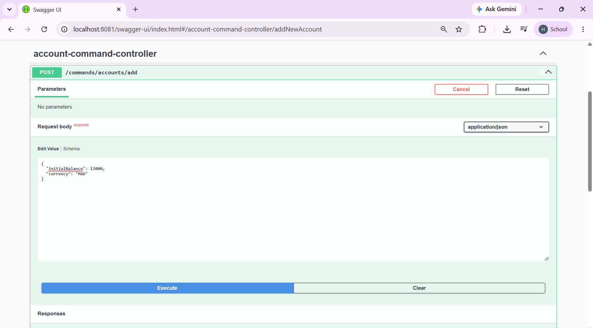

### 4.3 Erreur : aucun handler pour la commande

Tant que la commande n'est pas traitée par un agrégat, l'envoi échoue avec l'erreur `No handler was subscribed for command`.

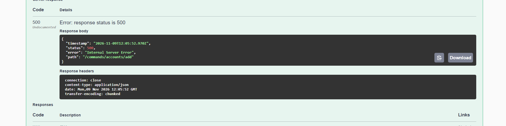

Pour afficher le message d'erreur côté client, un `@ExceptionHandler` retournant `exception.getMessage()` a été ajouté au contrôleur :

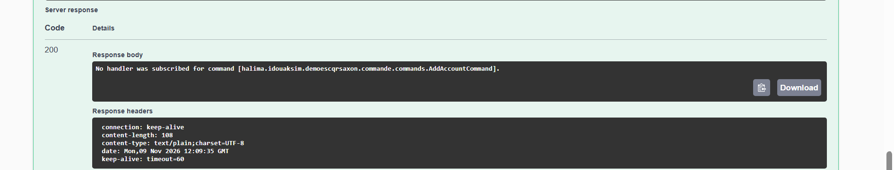

### 4.4 Création de l'agrégat `AccountAggregate`

L'agrégat contient :

- un constructeur sans argument (obligatoire pour Axon) ;
- un constructeur annoté `@CommandHandler` recevant `AddAccountCommand` (règle métier : solde initial > 0) ;
- un `@EventSourcingHandler` pour `AccountCreatedEvent` qui initialise l'état (id, solde, statut).

Premier test de la création d'un compte :

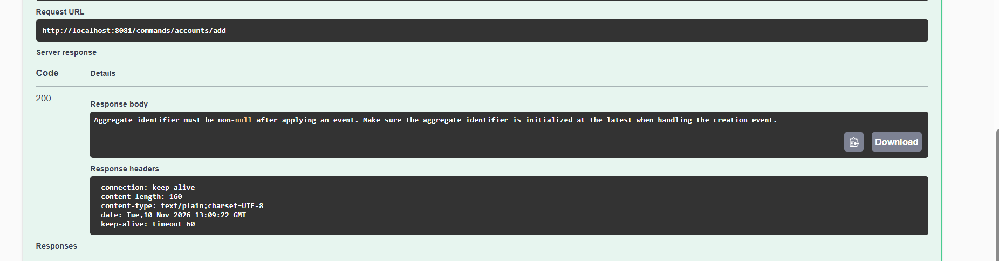

### 4.5 Ajout de l'annotation `@AggregateIdentifier`

Un problème est apparu : *l'identifiant de l'agrégat ne peut pas être nul*. Il faut :

- `@TargetAggregateIdentifier` sur l'identifiant dans la **commande** ;
- `@AggregateIdentifier` sur l'attribut `accountId` dans l'**agrégat**.

C'est grâce à ces deux annotations qu'Axon associe la commande à l'agrégat.

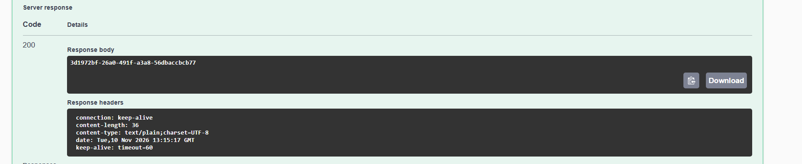

### 4.6 Event Store en mémoire (H2)

Avec la configuration par défaut, Axon crée ses propres tables dans H2 (console H2 activée).

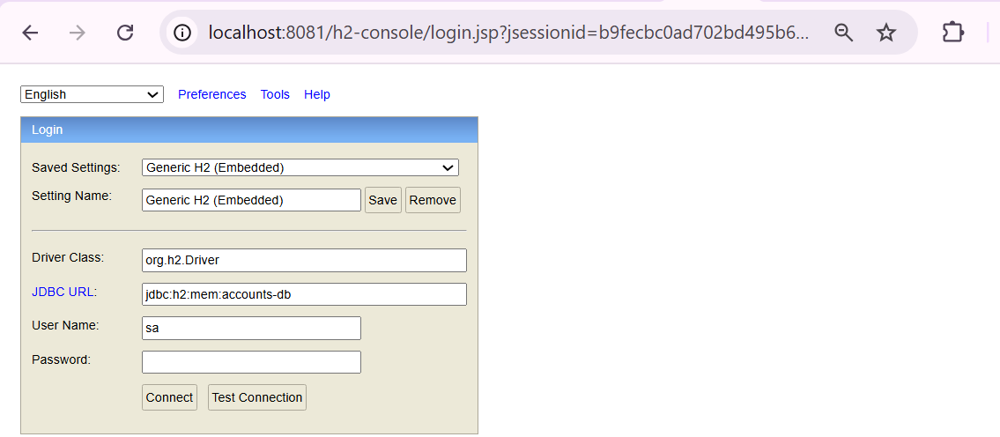

Les événements sont stockés dans la table `domain_event_entry` (identifiant de l'agrégat, type, timestamp, payload, métadonnées…).

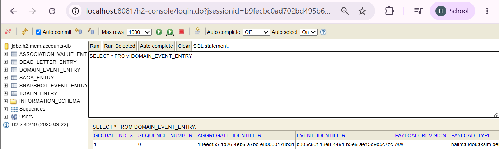

### 4.7 Passage à PostgreSQL avec Docker Compose

Un fichier `docker-compose.yml` démarre PostgreSQL et pgAdmin (réseau et volumes dédiés).

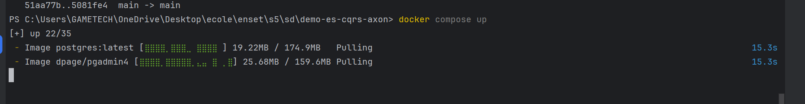

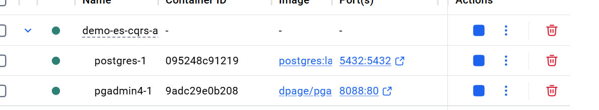

Intégration de la base PostgreSQL dans IntelliJ (Database → Data Source) :

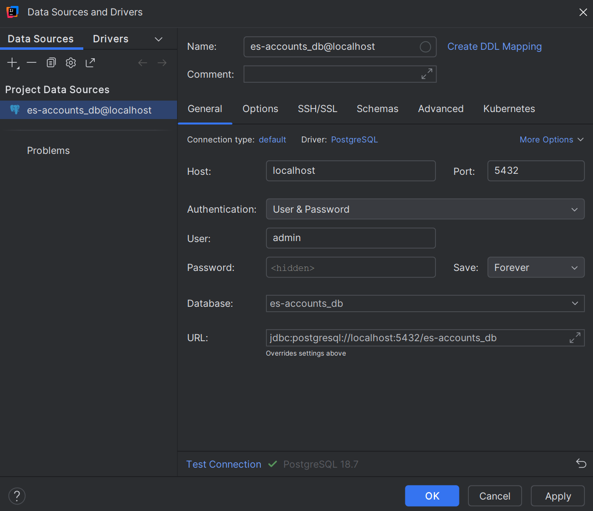

Test d'ajout d'un compte avec PostgreSQL : l'événement `AccountCreatedEvent` est bien persisté dans `domain_event_entry`.

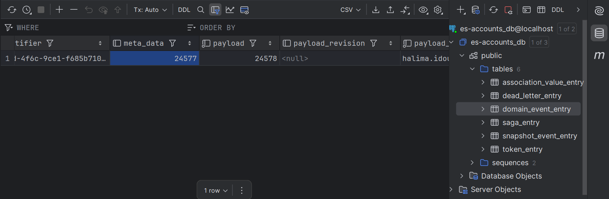

### 4.8 Sérialisation des événements en JSON

Par défaut, Axon sérialise les événements en **XML**. On configure **Jackson** pour stocker le payload au format **JSON** :

```properties
axon.serializer.events=jackson
axon.serializer.general=jackson
axon.serializer.messages=xstream
```

Un endpoint de test `GET /commands/account/events/{accountId}` lit les événements d'un agrégat via `EventStore.readEvents(accountId)` :

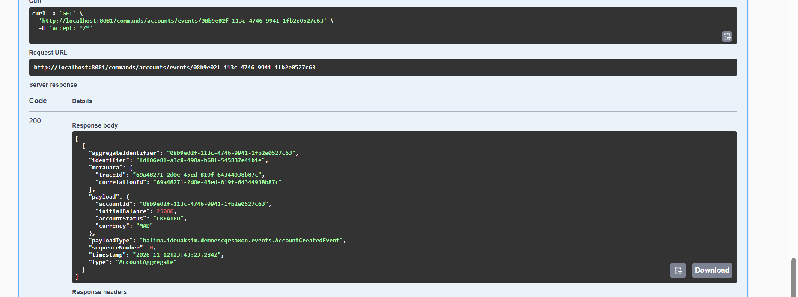

### 4.9 Activation automatique du compte

À la création d'un compte, l'agrégat émet **deux événements** : `AccountCreatedEvent` puis `AccountActivatedEvent`. Chaque événement nécessite son `@EventSourcingHandler` (sinon l'état de l'agrégat reste `CREATED`, et les opérations échouent avec *account is not activated*).

**1. Création du compte**

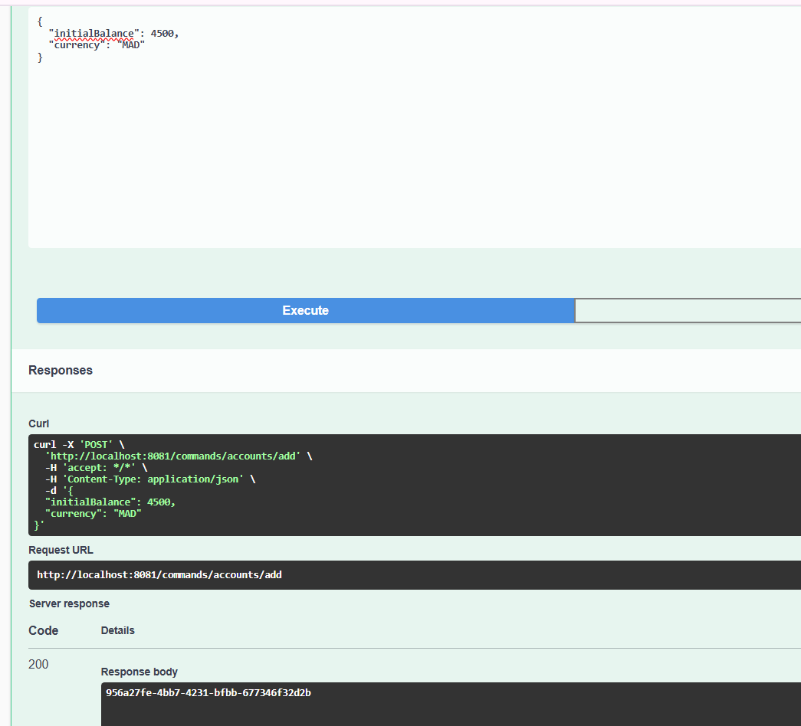

**2. Deux événements enregistrés (création et activation)**

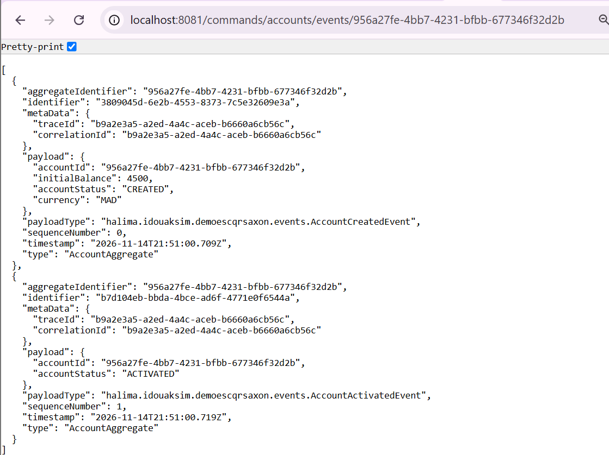

### 4.10 Crédit d'un compte

Nouvelle chaîne : `CreditAccountRequestDTO` → `CreditAccountCommand` → handler dans l'agrégat (compte activé, montant positif) → `AccountCreditedEvent` → `@EventSourcingHandler` (`balance += amount`).

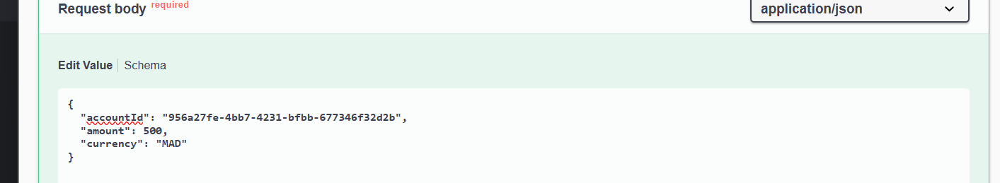

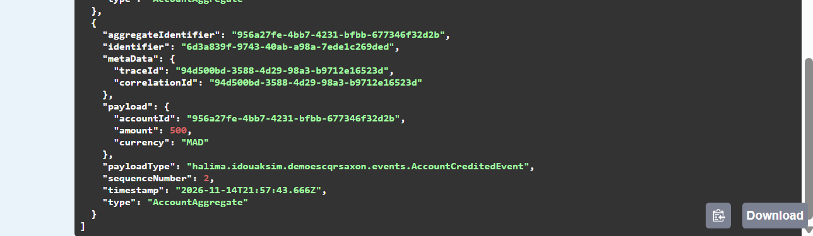

### 4.11 Débit d'un compte

Mêmes étapes, avec une règle métier supplémentaire : le **solde doit être suffisant**. Un débit supérieur au solde est refusé et aucun événement n'est ajouté à l'Event Store.

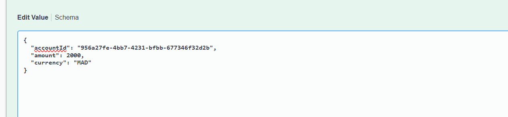

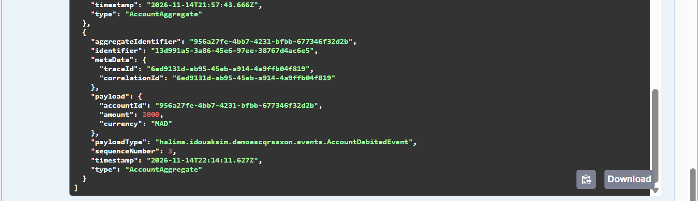

### 4.12 Changement de statut

`PUT /commands/account/updateStatus` : règle métier — le compte ne doit pas déjà être dans le statut demandé. Un compte `SUSPENDED` ne peut plus être crédité ni débité tant qu'il n'est pas réactivé.

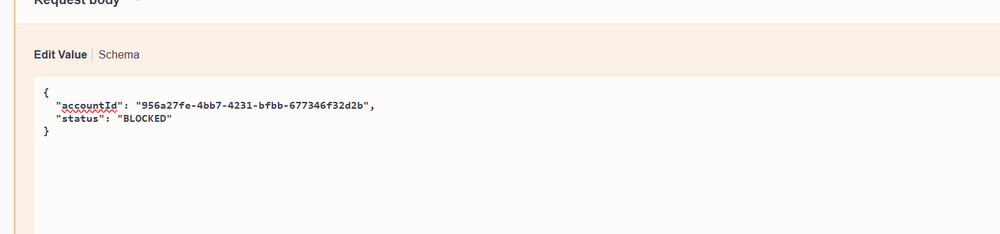

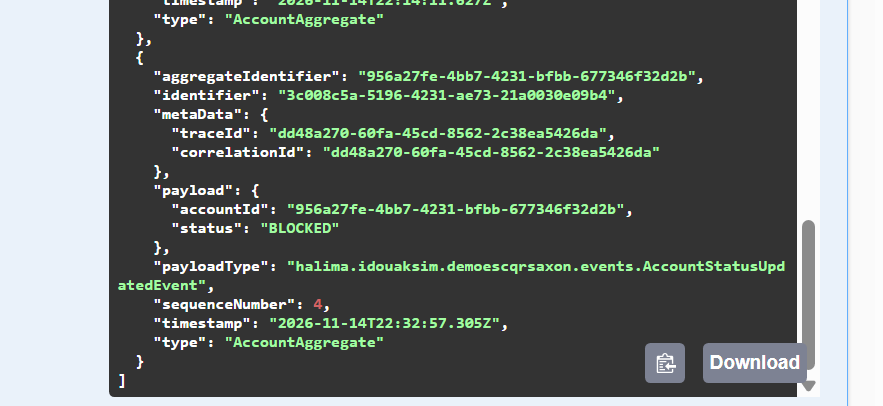

---

## 5. Partie Query (lecture)

### 5.1 Modèle de lecture

Deux entités JPA (Lombok : getters/setters, constructeurs, builder) :

- `Account` : `id`, `balance`, `status` (`@Enumerated(STRING)`), `currency`, `createdAt` (`Instant`)
- `AccountOperation` : `id` (auto-généré), `timestamp`, `amount`, `type` (`CREDIT`/`DEBIT`), `currency`, `account` (`@ManyToOne`)

Repositories : `AccountRepository` et `AccountOperationRepository` (avec `findByAccountId`).

### 5.2 Projection des événements (`AccountEventHandler`)

Les `@EventHandler` s'abonnent aux événements et alimentent la base de lecture. L'`EventMessage` permet de récupérer le timestamp technique de l'événement.

| Événement | Action dans la base de lecture |
|---|---|
| `AccountCreatedEvent` | Création de l'entité `Account` |
| `AccountActivatedEvent` | Mise à jour du statut |
| `AccountStatusUpdatedEvent` | Mise à jour du statut |
| `AccountCreditedEvent` | Création d'une opération `CREDIT` + solde `+` |
| `AccountDebitedEvent` | Création d'une opération `DEBIT` + solde `-` |

Au démarrage, Axon **rejoue** les événements passés vers les handlers (*replay*) :

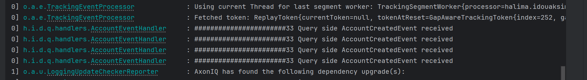

La base de lecture contient alors les tables `account` et `account_operation` :

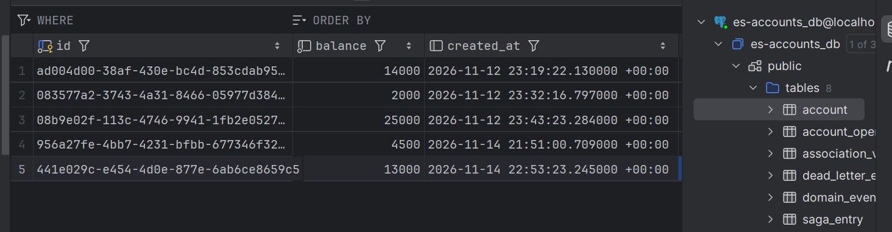

> **Remarque** : Axon mémorise la position du dernier événement traité dans la table `token_entry`. En cas de besoin de rejouer tous les événements, il faut vider cette table (et les tables de lecture). Attention également à ne pas utiliser `ddl-auto=create` qui écrase la base à chaque redémarrage : utiliser `update`.

### 5.3 Contrôleur de requêtes et Query Handler

`AccountQueryController` utilise le `QueryGateway` ; `AccountQueryHandler` (`@QueryHandler`) interroge la base de lecture.

Synchronisation entre la base d'écriture (Event Store) et la base de lecture :

`http://localhost:8081/query/accounts/all`

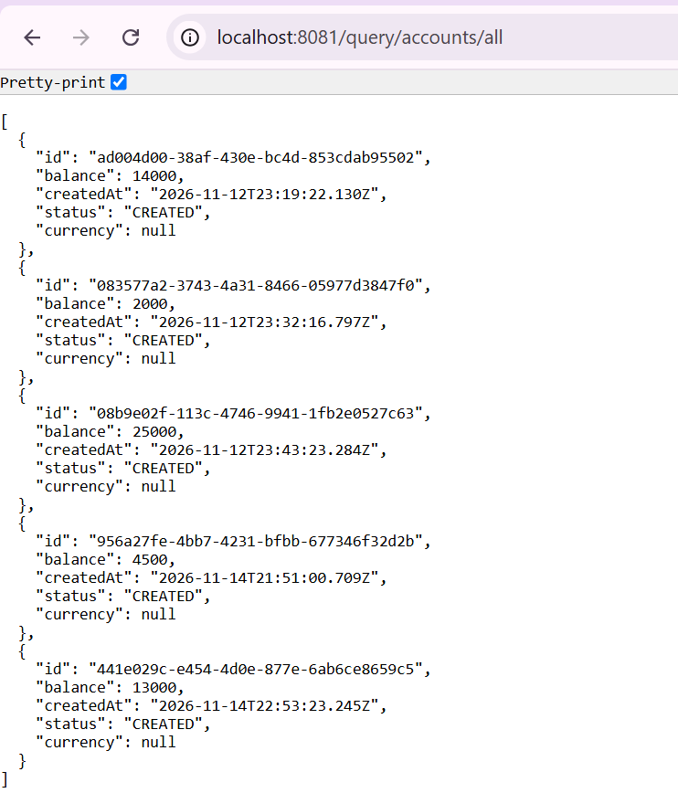

### 5.4 Relevé de compte (*Account Statement*)

`GET /query/accounts/accountStatement/{accountId}` retourne un `AccountStatementResponseDTO` (le compte + la liste de ses opérations) via `GetAccountStatementQuery` et `ResponseTypes.instanceOf(...)`.

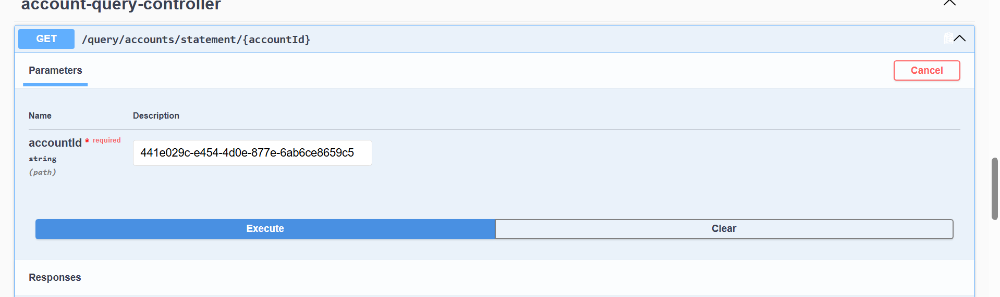

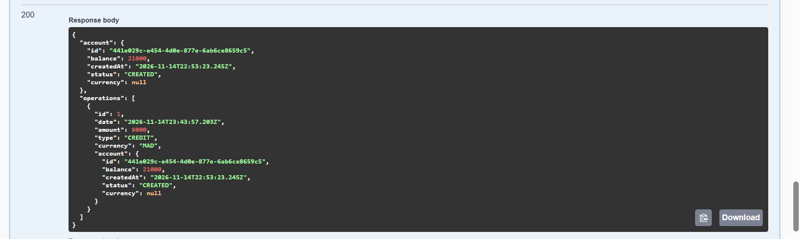

### 5.5 Suivi en temps réel (*Watch*)

Un endpoint `GET /query/accounts/watch/{accountId}` retourne un `Flux<AccountOperation>` (`text/event-stream`) grâce à une **subscription query** (`WatchEventQuery`). Côté handlers, le `QueryUpdateEmitter` pousse chaque opération (crédit/débit) vers les abonnés.

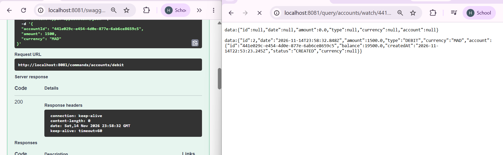

---

## 6. Passage à Axon Server

Jusqu'ici l'Event Store est en base de données : cela fonctionne pour une application monolithique, mais pas pour un système distribué (pas de broker pour distribuer les événements entre microservices).

Pour utiliser **Axon Server** :

1. Retirer l'exclusion de `axon-server-connector` dans le `pom.xml`.
2. Ajouter le service `axon-server` au `docker-compose.yml` (dashboard sur le port **8024**).
3. Redémarrer l'application : elle se connecte à Axon Server via **gRPC** (communication bidirectionnelle et réactive).

Les événements ne sont alors plus stockés dans PostgreSQL mais dans Axon Server :

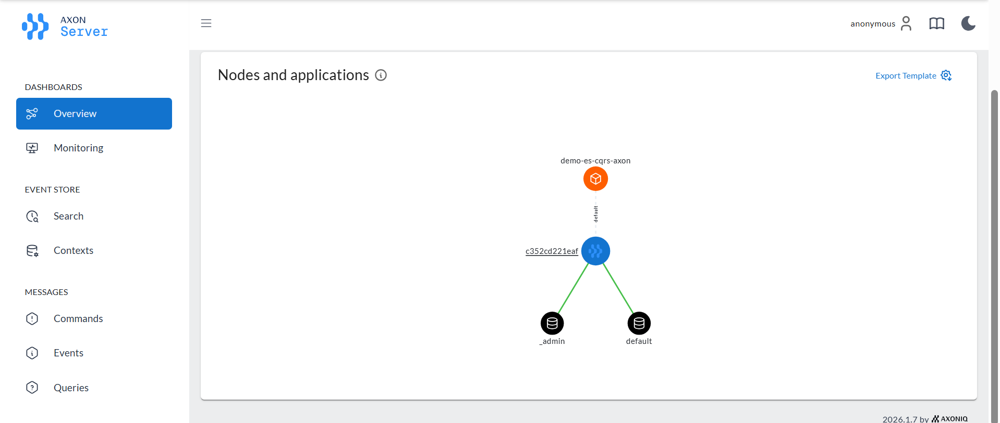

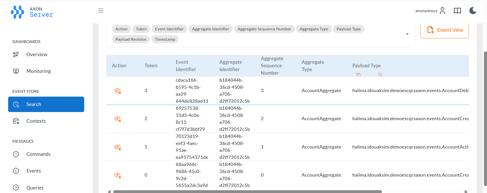

---

## 7. Lancer le projet

```bash
# 1. Démarrer PostgreSQL, pgAdmin et Axon Server
docker compose up -d

# 2. Lancer l'application Spring Boot
./mvnw spring-boot:run
```

### Endpoints

| Méthode | URL | Description |
|---|---|---|
| POST | `/commands/account/add` | Créer un compte |
| POST | `/commands/account/credit` | Créditer un compte |
| POST | `/commands/account/debit` | Débiter un compte |
| PUT | `/commands/account/updateStatus` | Changer le statut |
| GET | `/commands/account/events/{accountId}` | Lire les événements d'un compte |
| GET | `/query/accounts/all` | Lister les comptes |
| GET | `/query/accounts/accountStatement/{accountId}` | Relevé d'un compte |
| GET | `/query/accounts/watch/{accountId}` | Flux temps réel (SSE) |

---

## 8. Conclusion

Ce TP a permis de mettre en œuvre un cycle complet **Commande → Événement → Projection → Requête** :

- les **commandes** sont validées par l'agrégat (règles métier) ;
- les **événements** sont la source de vérité et sont persistés dans l'Event Store ;
- la **base de lecture** est une projection optimisée pour la consultation ;
- **Axon Server** permet de distribuer les événements dans une architecture microservices.

Inconvénient observé : beaucoup de code répétitif (commande, DTO, événement, handlers pour chaque opération), compensé par une procédure claire et reproductible.