swagger

erreur (No handler was subscribed for command )

affichage de problem

test

ajout d'annotation @AggregateIdentifier
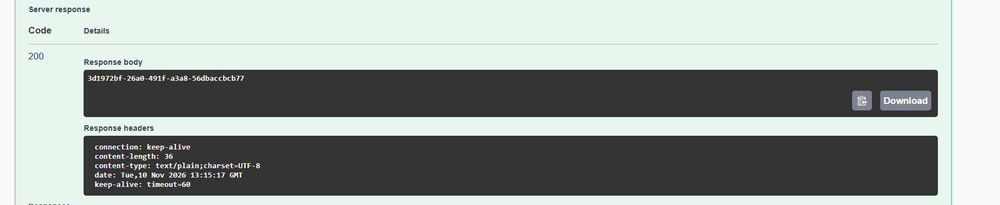

h2-console
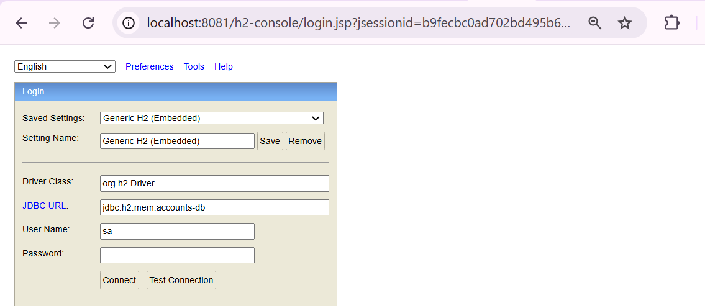

table domain_event_entry
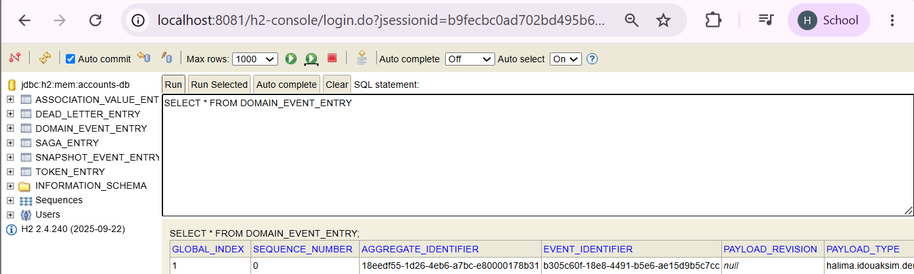

postgres docker compose
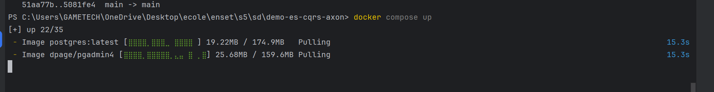
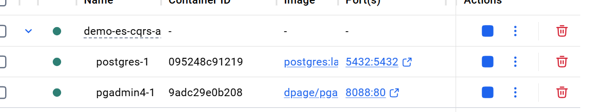

postgres integration in intellij
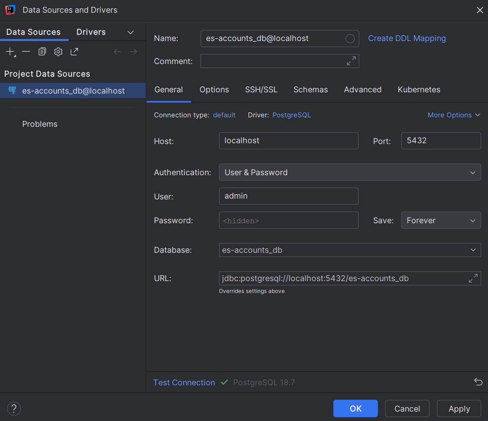

postgres test
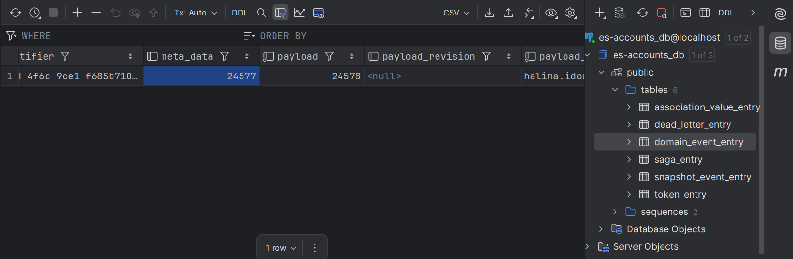

serialization test
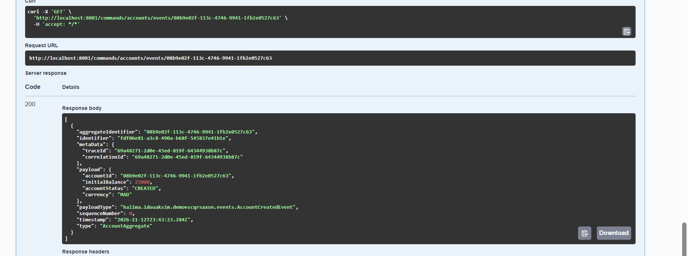

test d'activation automatique
1. creation de compte
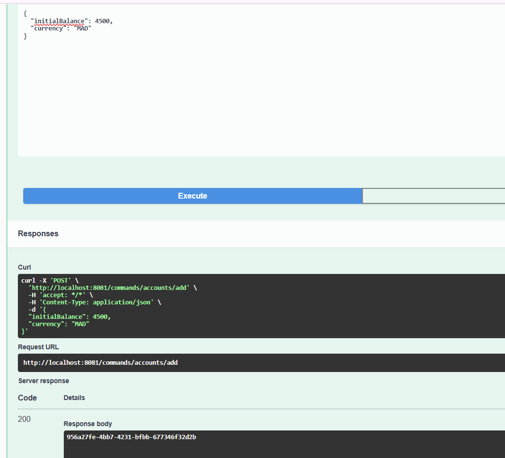
2. deux events dans le compte (creation et activation)
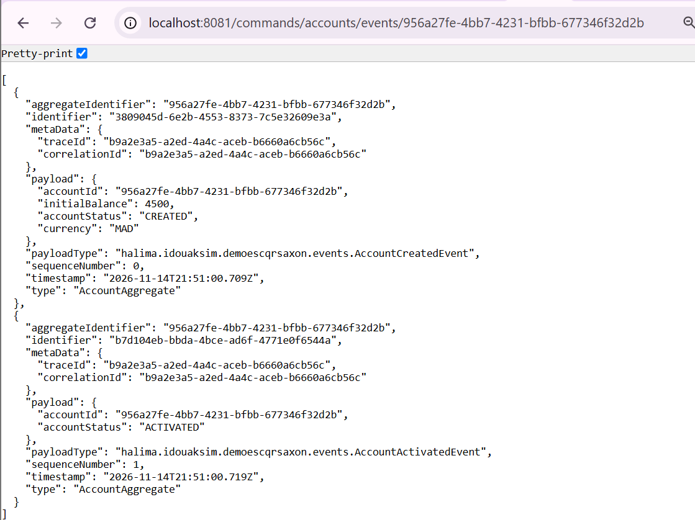

test de credit
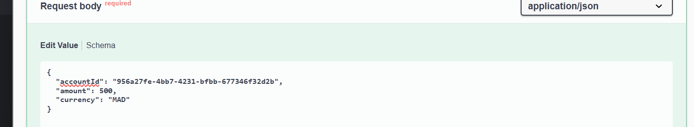
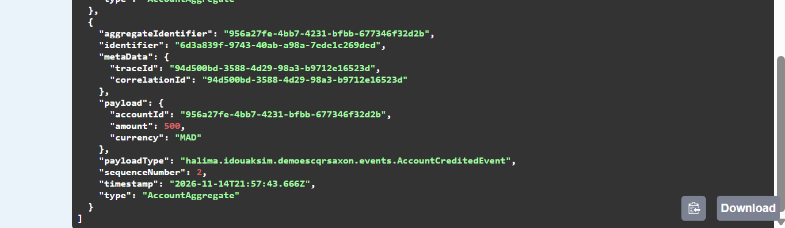

test de debit
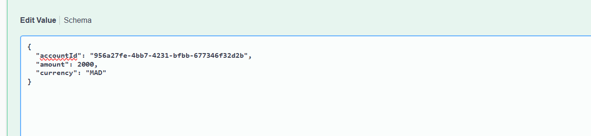
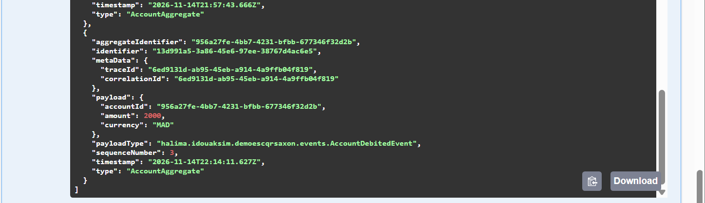
